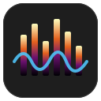
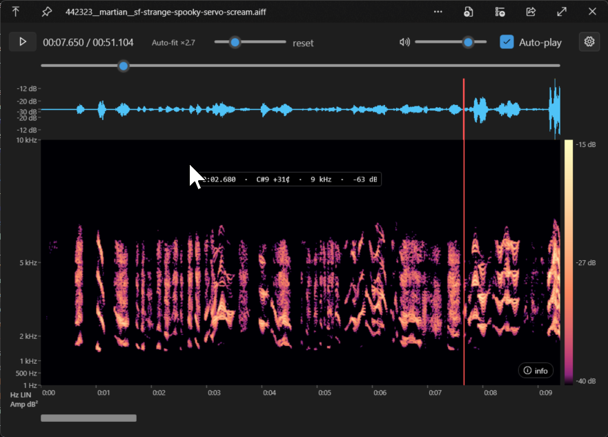

# QuickLook.Plugin.AudioViewer

[](LICENSE)

A [QuickLook](https://github.com/QL-Win/QuickLook) plugin that previews audio
files (`.wav .mp3 .flac .ogg .oga .m4a .aac .wma .aif .aiff`) with a waveform,
a moving playhead, playback transport (play/pause, seek, volume, persisted
auto-play), and a configurable spectrogram.



## Spectrogram

A gear (⚙) button in the toolbar opens a settings flyout. All choices persist:

- **Layout** — *Stacked* (waveform above spectrogram, the default) or *Single view*
  (a button toggles between the full-area waveform and spectrogram).
- **Frequency scale** — Linear, Log, or Mel.
- **Amplitude** — Decibel (dB) or Linear.
- **Colormap** — Magma, Viridis, or Grayscale.
- **FFT size** — 512 / 1024 / 2048 / 4096 (time-vs-frequency resolution).
- **Max frequency** — Full / 20 kHz / 10 kHz / 5 kHz.
- **Contrast** — dB-floor slider.
- **Show file info** — a bottom-right, draggable, closable overlay with embedded
  tags (title, artist, album, year, genre) and cover art when present, plus the
  file's format, decoder, sample rate, channels, bit depth, encoding, bitrate, and
  duration.

Display changes re-render instantly from cached FFT data; only an FFT-size change
recomputes the transform.

Long files render in full: the waveform and spectrogram share one horizontally
scrollable timeline (they stay aligned in time), and the view auto-follows the
playhead during playback. Short files fill the pane with no scrollbar.

The UI follows QuickLook's light/dark theme. Click the waveform (or the seek bar)
to jump to a position.

## Keyboard shortcuts

When the preview has focus:

| Key | Action |
| --- | --- |
| `K` | Play / pause |
| `J` / `L` | Seek back / forward 5 s |
| `M` | Mute / unmute |
| `+` / `-` | Volume up / down |

(Space and the arrow keys are intentionally left to QuickLook itself, which uses
them to open/close previews and move between files.)

## Build

```
git clone --recurse-submodules <this repo>
dotnet build QuickLook.Plugin.AudioViewer/QuickLook.Plugin.AudioViewer.csproj -c Release
powershell -File Scripts/pack-zip.ps1
```

Produces `QuickLook.Plugin.AudioViewer.qlplugin`.

## Install

1. In QuickLook, press **Space** on `QuickLook.Plugin.AudioViewer.qlplugin`.
2. Confirm the install prompt.
3. Restart QuickLook.

Then press **Space** on any supported audio file.

## Tests

```
dotnet test tests/QuickLook.Plugin.AudioViewer.Tests
```

## Requirements

- Windows with **.NET Framework 4.8** (built in on Windows 10 1903+ / Windows 11;
  installable on older Windows). Media Foundation codecs are used for FLAC/AAC/M4A/WMA.
- QuickLook.

## Releases

Pushing a version tag (e.g. `git tag v1.4.0 && git push origin v1.4.0`) runs the
release workflow, which builds, packages the `.qlplugin`, and attaches it to a
GitHub Release. CI builds and runs the tests on every push/PR. See
[CHANGELOG.md](CHANGELOG.md) for release notes.

## License

[MIT](LICENSE) © nielsr2.

## Acknowledgements

- [QuickLook](https://github.com/QL-Win/QuickLook) — the host application (GPL-3.0).
- [QuickLook.Common](https://github.com/QL-Win/QuickLook.Common) — the plugin API this
  project builds against (MIT). Its assembly is supplied by the host at runtime, not
  redistributed here.
- [NAudio](https://github.com/naudio/NAudio),
  [NAudio.Vorbis](https://github.com/naudio/Vorbis), and
  [NVorbis](https://github.com/NVorbis/NVorbis) — MIT.

Full third-party license texts are in [THIRD-PARTY-NOTICES.md](THIRD-PARTY-NOTICES.md).
